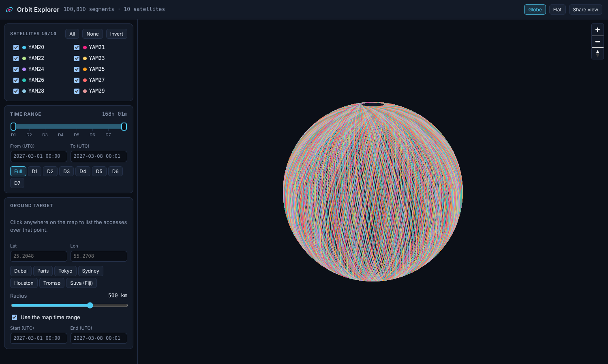
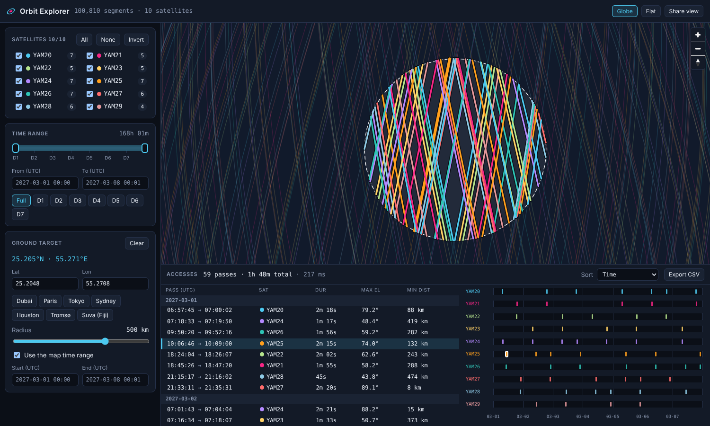
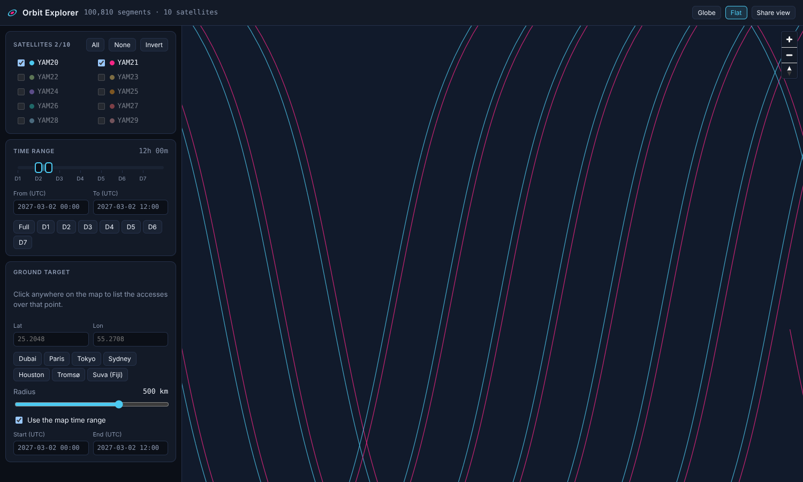
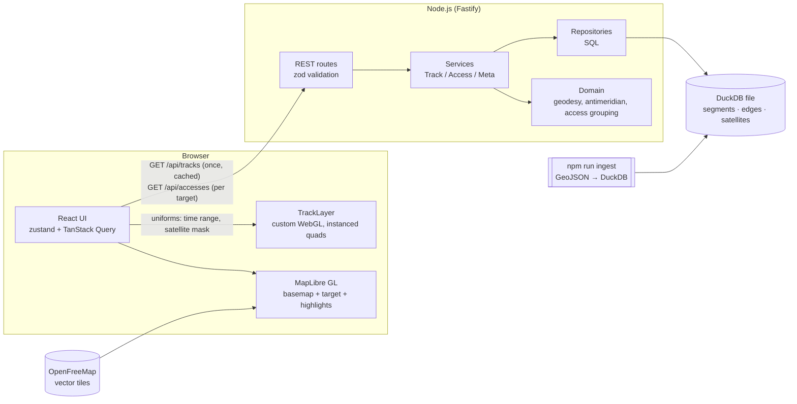

# Orbit Explorer

Map-centric explorer for satellite passes: browse a week of tracks for 10 spacecraft, filter them
instantly by satellite and time, drop a pin anywhere to get the **accesses** (passes within a radius, in a
time window) as a synchronised map + list + timeline, and share the exact view as a URL.



| Accesses over a ground point                   | Flat map, filtered by satellite and time  |
| ---------------------------------------------- | ----------------------------------------- |
|  |  |

> Screenshots were taken in a sandbox without internet, so the OpenStreetMap vector basemap is replaced
> by the built-in offline fallback (plain dark globe). With network access the basemap is
> [OpenFreeMap](https://openfreemap.org) (OpenMapTiles schema, OpenStreetMap data).

---

## Table of contents

1. [Quick start](#quick-start)
2. [Features](#features)
3. [Architecture](#architecture)
4. [Key decisions](#key-decisions-and-trade-offs)
5. [API reference](#api-reference)
6. [Performance](#performance)
7. [Testing strategy](#testing-strategy)
8. [CI/CD and delivery](#cicd-and-delivery)
9. [Repository layout](#repository-layout)
10. [Working with coding agents](#working-with-coding-agents)
11. [Known limitations and next steps](#known-limitations-and-next-steps)

---

## Quick start

Requirements: Node.js ≥ 22 (or just Docker).

### Docker (one command)

```bash
docker compose up --build        # → http://localhost:3000
```

The image serves the API and the built SPA from one process. On first start it builds the DuckDB file from
`./data/Altair-2P5S-tracks-1w.json` (≈ 5 s, mounted read-only) and persists it in the `orbit-db` volume, so
later restarts are instant.

### Local development

```bash
npm ci
npm run ingest                   # GeoJSON → data/db/tracks.duckdb  (≈ 5 s)
npm run dev                      # API :3000 (tsx watch) + Vite :5173 (proxy /api → :3000)
```

### Useful scripts

| Command                              | What it does                                                     |
| ------------------------------------ | ---------------------------------------------------------------- |
| `npm run check`                      | lint + typecheck + unit tests (what CI's first two jobs run)     |
| `npm run lint` / `npm run format`    | ESLint · Stylelint · Prettier (check / write)                    |
| `npm run typecheck`                  | `tsc --noEmit` for every workspace                               |
| `npm test` / `npm run test:coverage` | Vitest across all workspaces (+ V8 coverage with thresholds)     |
| `npm run build && npm start`         | production build; API serves the SPA when `WEB_DIST` is set      |
| `npm run test:e2e`                   | Playwright smoke suite against a running server (`E2E_BASE_URL`) |

Configuration is by environment variable, see [`.env.example`](.env.example).
---

## Features

**1 — Display passes on a map (snappy)**

- All **100 810 one-minute segments / 705 670 vertices** are drawn at once, on a globe or a flat map (toggle).
- **Satellite filter**: per-satellite checkboxes, _All / None / Invert_, and an _only_ shortcut (solo).
- **Time-range filter**: dual-handle slider (drag the bar to slide the whole window), UTC date-time fields,
  one-click day presets (`D1…D7`). Changes are applied on the GPU — see [ADR-002](docs/adr/002-gpu-track-layer.md) —
  so the map reacts within a frame.
- Hover any track for a tooltip (satellite + time).

**2 — Accesses for the next days**

- Click the map (or type coordinates, or pick a preset city) to set a **ground target**.
- Choose a **radius** (10 – 3 000 km, logarithmic slider) and a **time window** (follows the map range, or untick
  _Use the map time range_ to set an independent start/end).
- The map highlights only the **portions of tracks inside the radius**, clipped _exactly_ at the circle
  boundary; the rest of the constellation dims.
- A day-grouped **pass list** shows start → end, duration, **max elevation** and **closest distance**, sortable
  by time / elevation / duration / distance, and exportable to **CSV**.

**Synchronised views**

- Hover or select a pass in the **list**, the **per-satellite timeline** or on the **map** — all three highlight
  the same pass. Selecting from the list/timeline flies the camera to it.
- Per-satellite pass counts appear in the satellite panel.
- **Shareable state**: every filter, the target, radius, window and the selected pass live in the URL
  (`Share view` button copies it). Opening such a link restores the view.

Derived values per pass: time of closest approach (TCA), closest ground distance, **elevation and slant range at
TCA** (spherical-earth geometry from the 500 km orbit altitude in the data).

---

## Architecture



**Who does what**

| Concern                                         | Where                  | Why                                                                    |
| ----------------------------------------------- | ---------------------- | ---------------------------------------------------------------------- |
| Static, big, filtered constantly (the overview) | **client, GPU**        | Fetched once (1.8 MB gzip), uploaded once, filtered by shader uniforms |
| Dynamic, selective, needs exact math (accesses) | **server, DuckDB SQL** | One vectorised scan over 600 k edges, ~50–250 ms, tiny response        |

**Backend layering** (`apps/api/src`) — dependencies point inwards:

```
http/  (routes, error envelope)      → services/  (use-cases)      → repositories/ (SQL)  → infra/ (DuckDB)
                                       └── domain/ (pure functions: geodesy, antimeridian, access building)
```

`http/app.ts#buildApp` is the composition root: it takes a `Database` and a config, so tests build the whole
app on an in-memory DuckDB with synthetic orbits.

**Contract package** (`packages/contract`) holds the zod schemas shared by API and UI: one source of truth for
request validation (server), response parsing (client) and TypeScript types.

**Frontend layering** (`apps/web/src`): `api/` (fetch + hooks) · `state/` (store, URL codec) · `lib/` (pure,
unit-tested helpers) · `components/` (presentational panels) · `map/` (imperative MapLibre/WebGL shell).

### Data model (DuckDB)

| Table        | Grain                         | Used for                                                 |
| ------------ | ----------------------------- | -------------------------------------------------------- |
| `satellites` | 1 / spacecraft                | catalogue + stats (`/api/meta`)                          |
| `segments`   | 1 / source feature (1 minute) | overview polylines (`/api/tracks`)                       |
| `edges`      | 1 / consecutive vertex pair   | exact geographic query (`/api/accesses`), sorted by time |
| `meta`       | key/value                     | dataset fingerprint (SHA-256 of the source), counts      |

### What the data looked like (and what I did about it)

| Finding (profiling the GeoJSON)                                                                      | Handling                                                                                     |
| ---------------------------------------------------------------------------------------------------- | -------------------------------------------------------------------------------------------- |
| 100 810 features = 10 satellites × 10 081 contiguous 1-minute segments, 7 vertices each (10 s apart) | vertex time is interpolated over `[ts_start, ts_end]`; segments chain end-to-start           |
| **1 134 features are typed `MultiLineString` but contain LineString-shaped coordinates**             | geometry is detected by coordinate _depth_, not declared type (`normalize.ts`, unit-tested)  |
| Those same features **cross the antimeridian unsplit** (lon jumps ≈ −180 → +180)                     | raw data kept; polylines are split at ±180° with an interpolated vertex when served/rendered |
| 3-D positions, altitude 490–545 km                                                                   | altitude kept → used for elevation / slant range                                             |

---

## Key decisions and trade-offs

Full write-ups live in [`docs/adr`](docs/adr). Headlines:

1. **DuckDB, but exact geometry in plain SQL instead of the `spatial` extension** ([ADR-001](docs/adr/001-duckdb-sql-geometry.md)).
   The extension must be downloaded at runtime (`INSTALL spatial`) which breaks air-gapped builds/sandboxes (it
   did here), and planar `ST_*` predicates are wrong across the antimeridian/poles. The problem is point-vs-polyline
   on a sphere; an azimuthal-equidistant projection centred on the target makes distance exact and the
   edge∩disc test a closed-form quadratic that DuckDB evaluates over all edges. Sampling vertices would miss
   passes between samples (vertices are ~75 km apart) and mis-time every boundary by up to 5 s.
2. **GPU filtering via a custom MapLibre layer** ([ADR-002](docs/adr/002-gpu-track-layer.md)). I first built the
   obvious thing — a GeoJSON source with `setFilter` — and **measured it**: seconds per filter change at 100 k
   features, because MapLibre re-tiles every feature whatever the filter matches. The custom layer uploads the
   dataset once; the time range and satellite mask are shader uniforms.
3. **REST, not GraphQL** ([ADR-003](docs/adr/003-rest-over-graphql.md)). Two read-only, well-bounded queries;
   REST gives HTTP caching (ETag/`Cache-Control`) for the big immutable payload for free.
4. **Ingest once, serve read-only.** `npm run ingest` (or first container boot) builds an on-disk DuckDB file
   atomically (`.tmp` + rename); the server opens it `READ_ONLY`.
5. **UTC everywhere, epoch seconds internally.** Float32 cannot hold 1.8e9 with 1 s precision, so the GPU
   receives times relative to the dataset start.
6. **DuckDB-WASM was not used.** Everything the browser must do continuously is a rendering problem (solved
   with typed arrays + shaders); the one analytical query is cheap on the server and returns a few KB. Shipping a
   ~30 MB engine plus the whole dataset to every client would trade away first-load time for no UX gain.
7. **Basemap**: OpenFreeMap vector style (OSM data, no key, not hosted by us), probed on start-up with an
   offline fallback so the app never shows a blank map. Override via `VITE_BASEMAP_STYLE_URL`.
8. **State**: zustand for UI state (selectors, no provider boilerplate), TanStack Query for server state
   (cancellation of stale requests, `keepPreviousData` so the list never flashes empty). URL codec is a pure,
   tested module.

---

## API reference

All times are UTC ISO-8601 (`2027-03-01T06:58:00Z`). Errors share one envelope:
`{ "error": { "code": "VALIDATION_ERROR" | "UNKNOWN_SATELLITE" | "NOT_FOUND" | …, "message": "…" } }`.

| Method & path       | Purpose                                                                                                  |
| ------------------- | -------------------------------------------------------------------------------------------------------- |
| `GET /api/health`   | liveness + dataset fingerprint                                                                           |
| `GET /api/meta`     | dataset extent, per-satellite stats                                                                      |
| `GET /api/tracks`   | columnar polylines. Query: `satellites=A,B` · `from` · `to` · `step=1..6` (vertex decimation, default 3) |
| `GET /api/accesses` | accesses over a point. Query: `lat` · `lon` · `radiusKm` (≤ 3000) · `from` · `to` · `satellites`         |

```bash
curl 'localhost:3000/api/accesses?lat=25.2048&lon=55.2708&radiusKm=500&from=2027-03-01T00:00:00Z&to=2027-03-02T00:00:00Z'
```

```jsonc
{
  "query": { "lat": 25.2048, "lon": 55.2708, "radiusKm": 500, "from": "…", "to": "…", "satellites": ["YAM20", "…"] },
  "summary": { "count": 9, "bySatellite": { "YAM20": 1 }, "totalDurationSeconds": 1043, "tookMs": 54 },
  "accesses": [{
    "id": "YAM20-1803884264",
    "satellite": "YAM20",
    "start": "2027-03-01T06:57:44Z", "end": "2027-03-01T07:00:02Z", "durationSeconds": 138,
    "tca": "2027-03-01T06:58:51Z",
    "minDistanceKm": 88.4, "maxElevationDeg": 79.2, "slantRangeKm": 507.1,
    "geometry": { "type": "LineString", "coordinates": [[lon, lat, altKm], …] }  // clipped to the radius & window
  }]
}
```

`/api/tracks` returns a **columnar** payload (`satellites, sat[], t0[], t1[], offsets[], coords[]`; see
`packages/contract`) — ~5× smaller than GeoJSON and parsed into typed arrays without per-feature objects. It is
immutable per dataset version, so it is served with a strong `ETag` and `Cache-Control: max-age=3600`.

An access is a contiguous run of track inside the disc: boundaries are interpolated on the disc edge (not
snapped to samples) and clipped to the requested window.

---

## Performance

Measured on the provided data set (1 vCPU sandbox, server-side, DuckDB 1.5):

| Operation                                                | Result                                                          |
| -------------------------------------------------------- | --------------------------------------------------------------- |
| Ingest (parse 61 MB GeoJSON → DuckDB, derive edges)      | **≈ 5.4 s** → 61 MB `.duckdb` file                              |
| `/api/accesses`, 500 km radius, full week (59 passes)    | **≈ 85 ms**                                                     |
| `/api/accesses`, 3 000 km radius, full week (365 passes) | ≈ 210–270 ms                                                    |
| `/api/accesses`, 1 day window                            | ≈ 45–55 ms (zone-map pruning on time)                           |
| `/api/tracks` overview                                   | 7.7 MB JSON → **1.8 MB** on the wire; built once, then memoised |
| Time-range / satellite filter on the map                 | 2 uniform writes + repaint — no worker, no re-upload            |

The "before" that motivated the GPU layer: with a GeoJSON source, a single `setFilter` took several seconds in
the same headless-Chromium sandbox (see ADR-002 for the method). The sandbox's software WebGL makes absolute
frame times unrepresentative, which is exactly why the architecture removes CPU work from the filter path
rather than tuning it.

---

## Testing strategy

`npm test` runs **165 tests** (≈ 94 % statement coverage, thresholds enforced in `vitest.config.ts`).

| Layer                | What is tested                                                                                                                            |
| -------------------- | ----------------------------------------------------------------------------------------------------------------------------------------- |
| **Domain** (API)     | haversine, look angles (nadir = 90°, horizon = 0°), antimeridian splitting, pass grouping/clipping                                        |
| **Ingest**           | the real-data quirks (mislabelled MultiLineString, genuine MultiLineString, bad timestamps, missing altitude)                             |
| **Repository/SQL**   | analytic scenarios (equator track: exact entry/exit times, cross-track distance, between-vertex pass, window clipping, antimeridian ±)    |
| **Differential**     | SQL result vs a **brute-force oracle** (0.05 s dense sampling + haversine) on random orbits and targets incl. 78° N, −88° and ±180°       |
| **HTTP**             | `fastify.inject` on an in-memory DB: validation errors, ETag/304, filters, error envelope                                                 |
| **Real data**        | (skipped unless the DB is built) counts, antimeridian-safety, Dubai passes match Orbitworks' list (YAM20 06:58, YAM24 07:19, YAM25 10:07) |
| **Frontend units**   | time/geo helpers, slider math, URL codec, store, track buffers + spatial hover index, CSV, sorting, debounce                              |
| **Components**       | slider (keyboard + pointer), satellite panel, time/target panels, table, timeline, date field                                             |
| **App integration**  | full `App` with mocked fetch + stubbed map: target → query → list → selection, error state                                                |
| **E2E** (Playwright) | real browser + real WebGL: catalogue, presets in URL, Dubai accesses, shared-link restore                                                 |

The WebGL layer itself is verified by the e2e run (and by screenshots in `docs/images`); its pure inputs
(`buildTrackBuffers`, visibility mask, hover index) are unit-tested.

---

## CI/CD and delivery

`.github/workflows/ci.yml` — concurrency-cancelled, least-privilege `permissions`, npm cache:

1. **quality** — ESLint · Stylelint · Prettier · `tsc`
2. **test** — builds the real DuckDB (cached by data hash) then runs unit/integration tests with coverage thresholds
3. **e2e** — production build → ingest → serve → Playwright (Chromium, software WebGL); report + server log on failure
4. **docker** — BuildKit with GHA layer cache → container smoke test (first-boot ingest, `/api/health`, SPA) →
   Trivy scan (fails on fixable HIGH/CRITICAL) → push to GHCR on `main`/tags with metadata-action tags

Also: `codeql.yml` (weekly + PRs), `dependabot.yml` (npm grouped, Docker, Actions), Husky + lint-staged pre-commit.

The Dockerfile is multi-stage (deps → build → prod-only deps → runtime), runs as the unprivileged `node` user, has a
`HEALTHCHECK`, and compose runs it `read_only` with `no-new-privileges`.

---

## Repository layout

```
apps/api            Fastify + DuckDB service (ingest CLI, repositories, services, domain, routes, tests)
apps/web            React + MapLibre SPA (components, state, lib, map/TrackLayer WebGL, e2e)
packages/contract   zod schemas + types shared by both
data/               source GeoJSON (the derived .duckdb lives in data/db, git-ignored)
docs/adr            architecture decision records
docs/AI_WORKFLOW.md how coding agents were used (strategy, instructions, guard-rails)
```

---

## Known limitations and next steps

- **Verification gaps in my build environment**: no Docker daemon (the Dockerfile's stages were replayed by hand and
  the production bundle booted from a clean prod-only install, but `docker build` itself has not been run), no
  internet (OpenFreeMap tiles were not fetched; the fallback style was exercised), no hardware GPU
  (WebGL ran on SwiftShader).
- Elevation is **geometric** (spherical earth, no refraction/terrain mask, no minimum-elevation filter). A
  `minElevationDeg` parameter is a natural extension: it is a monotone function of ground distance, so it can be
  converted into a radius server-side.
- Passes are derived from the **sampled** trajectory (10 s, linear between samples). That is sub-kilometre here;
  a real propagator (SGP4) would be needed beyond the supplied week.
- The GPU layer supports up to **16 satellites** (`MAX_SATELLITES`); a data-texture palette lifts that.
- A radius circle that encloses a pole is drawn as an outline only (no polygon fill).
- No authentication / rate limiting — add at the reverse proxy.
- Possible additions: multiple targets (ground-station network), pass-geometry hover with look-angle plot,
  iCal export, `spatial`-extension R-tree prefilter for much larger constellations (the SQL is already structured
  as `candidate prefilter → exact test`).
